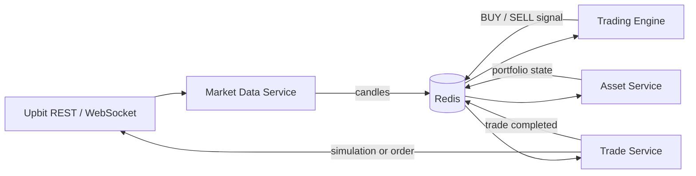

# Upbit Coin Bot Portfolio

[](https://github.com/dongkeonkim/upbit-coin-bot-portfolio/actions/workflows/ci.yml)

Upbit 공개 시세를 수집하고, ML·규칙 기반 전략으로 매매 신호를 생성해 모의 또는 실제 주문 흐름까지 연결한 이벤트 기반 트레이딩 시스템입니다. Python 트레이딩 엔진과 TypeScript 마이크로서비스를 Redis로 연결하고, Docker와 Kubernetes 환경에서 운영할 수 있도록 구성했습니다.

> 이 저장소는 운영이 종료된 프로젝트의 포트폴리오용 스냅샷입니다. 실제 투자 수익을 보장하지 않으며, 현재 운영·지원되지 않습니다.

## Architecture



| Component | Responsibility | Stack |
|---|---|---|
| Market Data Service | 공개 시세 수집, 거래대금 기반 마켓 선택, 캔들 발행 | TypeScript, Upbit API, Redis |
| Trading Engine | 기술지표 계산, ML/규칙 기반 신호, 백테스트, 실시간 루프 | Python, XGBoost, pandas |
| Trade Service | 모의 체결 또는 실제 주문, 중복 매도 방지 | TypeScript, Redis lock |
| Asset Service | 모의/실제 포트폴리오 동기화 | TypeScript, Redis |

## Engineering highlights

- 1분봉을 기반으로 한 멀티 타임프레임 피처와 코인별 XGBoost 모델
- 급락 반등 모델과 추세 추종 모델을 조합한 이중 전략 구조
- 수수료, 슬리피지, 손절·트레일링 스탑을 포함한 백테스트 엔진
- Redis 기반 이벤트 전달과 분산 락으로 중복 주문 및 포트폴리오 경쟁 조건 완화
- Kubernetes Lease 기반 Active–Standby leader election
- Docker Compose 로컬 실행과 Kubernetes/EKS 배포 템플릿
- 구조화 로그, Grafana/Loki 대시보드 및 Slack 알림 연동

설계 배경과 동시성 처리 과정은 [동시성 제어 문서](docs/ARCH_CONCURRENCY.md), ML 설계는 [ML 전략 가이드](docs/ML_STRATEGY_GUIDE.md)에서 확인할 수 있습니다.

## Quick start: simulation

Requirements: Docker with Compose support.

```bash
git clone https://github.com/dongkeonkim/upbit-coin-bot-portfolio.git
cd upbit-coin-bot-portfolio
cp .env.example .env
docker compose up --build
```

기본값은 `REAL_MODE=false`입니다. 이 상태에서는 Upbit 주문 API를 호출하지 않고 Redis에 가상 포트폴리오를 생성합니다. 시세 수집에는 인증이 필요 없는 Upbit 공개 API를 사용합니다.

```bash
# 서비스 상태
docker compose ps

# 트레이딩 엔진 로그
docker compose logs -f trading-engine

# 종료
docker compose down
```

## Backtest

백테스트는 PostgreSQL의 1분봉 데이터가 필요합니다. 데이터베이스 접속 정보는 `.env`의 `DB_*` 또는 `DATABASE_URL`로 전달하며, 원본 시장 데이터는 저장소에 포함하지 않았습니다.

```bash
cd services/trading-engine
python -m venv .venv
source .venv/bin/activate
pip install -e '.[dev]'

python -m src.main backtest \
  --period P1 \
  --strategy ml \
  --markets KRW-BTC KRW-ETH
```

전략 및 기간 옵션은 [백테스트 문서](docs/백테스트.md)를 참고하세요.

## Repository layout

```text
services/
├── asset-service/       # portfolio synchronization
├── market-data-service/ # public market-data ingestion
├── trade-service/       # simulated/live order execution
└── trading-engine/      # strategy, backtest, realtime engine
backtests/               # model training and optimization scripts
k8s/                     # generic Kubernetes/EKS templates
dashboards/              # Grafana dashboard
docs/                    # architecture, strategy, and operations notes
```

## Safety

- API 키와 Webhook은 커밋하지 말고 환경변수나 Secret manager로 주입하세요.
- 실제 주문은 `REAL_MODE=true`와 유효한 Upbit 키가 모두 있을 때만 활성화됩니다.
- 공개 포트폴리오 스냅샷이므로 실제 자금으로 실행하기 전에 코드와 거래소 정책을 직접 검증해야 합니다.
- 취약점 제보 방법은 [SECURITY.md](SECURITY.md)를 참고하세요.

## License

별도 오픈소스 라이선스를 부여하지 않은 포트폴리오 공개 코드입니다. 저작권자의 명시적 허가 없이 복제, 수정 또는 재배포할 수 없습니다.

