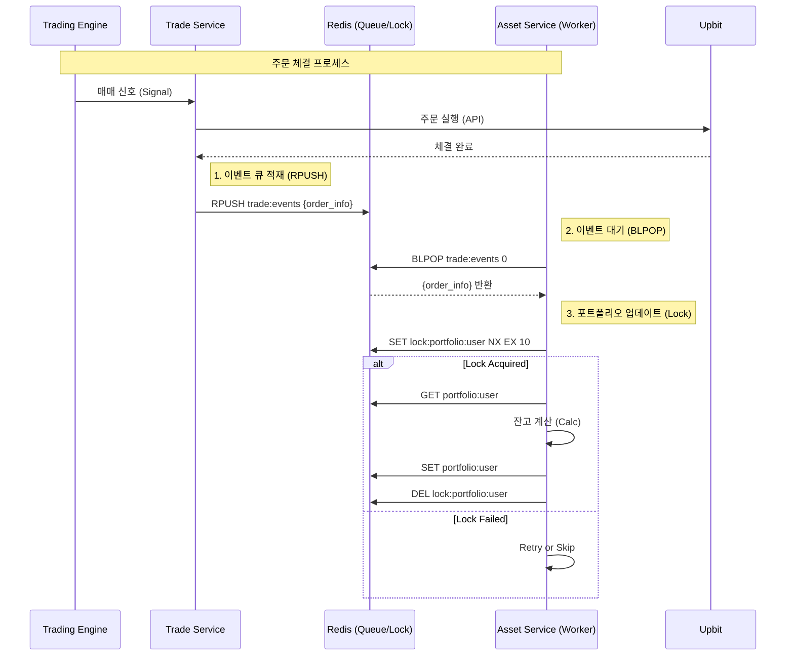

# 동시성 제어 및 메시지 큐 아키텍처 (Concurrency Control & Message Queue)

## 1. 배경 및 문제점 (Background & Problem)

### 1.1. 포트폴리오 데이터 불일치 (Race Condition)
다수의 트레이딩 전략이 동시에 매수/매도 신호를 발생시킬 때, `asset-service`가 포트폴리오(잔고)를 업데이트하는 과정에서 심각한 데이터 정합성 문제가 발생할 위험이 확인되었습니다.

*   **상황:** 봇 A와 봇 B가 거의 동시에 매수 주문 체결.
*   **문제:**
    1.  A가 잔고 조회 (1000만원)
    2.  B가 잔고 조회 (1000만원) -> **데이터 오염 시작**
    3.  A가 잔고 차감 후 저장 (900만원)
    4.  B가 잔고 차감 후 저장 (900만원) -> **A의 거래 내역 유실 (Lost Update)**
*   **결과:** 실제로는 200만원을 썼는데 장부상 100만원만 쓴 것으로 기록되거나(잔고 뻥튀기), 최악의 경우 마이너스 잔고 발생. 특히 **모의투자 모드**에서 치명적.

### 1.2. 이벤트 유실 (Event Loss)
기존의 **Pub/Sub** 방식은 `Fire-and-Forget` 모델이므로, `asset-service`가 잠시 재시작되거나 부하로 인해 처리가 지연될 때 체결 이벤트를 놓칠 수 있었습니다.

---

## 2. 해결 방안 (Solution)

### 2.1. Redis Distributed Lock (분산 락)
포트폴리오 수정 권한을 제어하기 위해 Redis 기반의 분산 락을 도입했습니다.

*   **원리:** `asset-service`가 포트폴리오를 수정하기 전 반드시 락을 획득해야 함.
*   **구현:**
    *   **Lock Key:** `lock:portfolio:{userId}`
    *   **Command:** `SET key value NX EX 10` (존재하지 않을 때만 설정, 10초 후 자동 만료)
    *   **Retry:** 락 획득 실패 시 200ms 간격으로 최대 3회 재시도.
    *   **Safety:** `finally` 블록을 통해 작업 종료 시 반드시 락 해제.

### 2.2. Redis Message Queue (메시지 큐)
이벤트 전달 방식을 Pub/Sub에서 **Queue(List)** 모델로 변경하여 **순차 처리(Sequential Processing)**를 보장했습니다.

*   **구조:** Producer-Consumer 패턴.
*   **Producer (`trade-service`):** 주문 체결 시 이벤트를 큐에 적재 (`RPUSH`).
*   **Consumer (`asset-service`):** 큐에서 이벤트를 하나씩 꺼내 처리 (`BLPOP`).

---

## 3. 아키텍처 다이어그램 (Architecture)

---

## 4. 기술적 세부사항 (Technical Details)

### 4.1. 왜 Redis Queue인가? (Why Redis?)
Kafka나 RabbitMQ 대신 Redis를 선택한 이유:
1.  **인프라 단순화:** 이미 시세 저장용으로 Redis를 사용 중이므로 추가 관리 비용 없음.
2.  **초저지연 (Low Latency):** In-Memory 기반으로 마이크로초 단위 처리 가능. 초단타 매매에 적합.
3.  **구현 용이성:** `RPUSH`/`BLPOP` 명령어만으로 강력한 FIFO 큐 구현 가능.

### 4.2. RedisQueueClient
*   **Worker Loop:** `while(isRunning)` 루프 안에서 `blpop`으로 대기.
*   **Blocking:** 이벤트가 없을 때는 CPU를 사용하지 않고 대기(Idle). 이벤트가 들어오는 즉시 깨어나 처리.

---

## 5. 운영 및 모니터링 (Operations)

### 5.1. 큐 적체 감지 (Lag Monitoring)
*   **주기:** 5초마다 체크.
*   **명령어:** `LLEN trade:events`
*   **임계값:** 대기 중인 이벤트가 **2개 이상**일 경우 경고.
*   **알림:** Slack으로 `:rotating_light: Asset Service Lag Alert` 발송.

### 5.2. 장애 대응
*   **락 해제 실패:** TTL(10초) 설정으로 인해 데드락(Deadlock) 방지.
*   **워커 에러:** `try-catch`로 감싸져 있어 에러 발생 시 1초 대기 후 재시작 (서비스 멈춤 방지).
